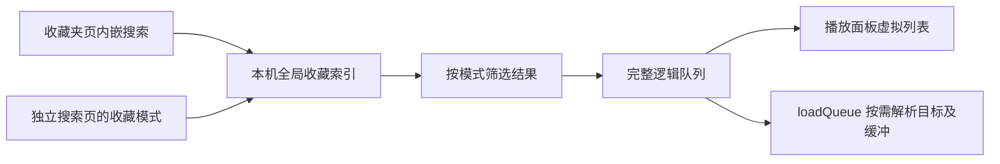

# 收藏夹搜索模式与播放队列修复

## 1. 背景与目标

用户反馈收藏夹搜索失去按作者、关键词区分的能力；搜索结果多于播放列表当前可见条目时，后续条目无法通过播放列表滚动访问。目标是恢复清晰的搜索条件，使完整搜索结果能够进入并浏览播放队列，分阶段本地提交。

约束：沿用 React Native 0.74.5、现有主题和 FlatList；不修改登录、远端收藏写入和音频解析策略；保留虚拟列表与按需原生缓冲；不推送远端。

## 2. 调用链与关键证据

已确认：

- 收藏夹页 `FoldersScreen` 有独立内嵌搜索，原筛选混合视频标题、UP 主和来源名称，没有搜索模式。
- 发现页进入的 `SearchScreen` 还有收藏搜索入口，原筛选混合视频标题与 UP 主，也没有模式。
- `FoldersScreen` 点击搜索结果时只将前 100 条传给 `setQueue` / `loadQueue`，并传入空播放上下文。点击第 101 条以后的结果会使目标 BVID 不在队列中。
- `loadQueue` 用 `Math.max(0, findIndex(...))` 选择目标，目标缺失时会回退到第一条；这是上述路径播放错误视频的原因。
- `SearchScreen` 将完整结果传入逻辑队列，并未截断为 5 首。`PlaylistPanel` 显示的是逻辑队列，原生 TrackPlayer 另有按需缓冲。
- `PlaylistPanel` 外层只有 `maxHeight: '80%'`，FlatList 缺少收缩约束；玻璃主题的 `GlassView` 还嵌套了未传递高度约束的容器。

合理推断：播放面板内容按自然高度展开后被可见区域裁切，可能导致用户看到前几首却无法滚到底。当前没有连接的 ADB 设备，尚未在原生布局引擎中复现，不能把该推断视为设备验证结论。

## 3. 实施方案与取舍

1. 恢复关键词、作者两个模式，两个入口复用匹配逻辑，模式纳入播放上下文和刷新标识，避免同词不同模式互相覆盖。
2. 去掉内嵌搜索的逻辑队列截断，继续由 FlatList 虚拟化和 TrackPlayer 按需缓冲控制开销。
3. 将播放面板的可用高度传到实际列表，覆盖玻璃、普通主题与底部安全区。
4. 回归测试覆盖字段隔离、模式刷新标识、超过旧截断边界的结果，以及未在原生缓冲中的后段条目播放。

## 4. 验证记录

### 第一阶段：搜索模式

- 两个入口增加关键词/作者按钮及对应输入提示，切换时保留输入。
- 历史实现确认关键词模式按标题匹配、作者模式按 `upper.name` 匹配，恢复该字段边界；不再把来源名称和作者混入关键词结果。
- 新增统一索引构建与筛选函数，独立搜索页继续缓存规范化标题/作者，避免每次输入重新规范化索引。
- 新播放上下文携带模式，刷新键按账号、模式和规范化搜索词隔离；没有模式的旧持久化上下文沿用旧键和标题或作者混搜行为。
- 搜索页和播放面板刷新均使用相同的匹配函数，避免刷新扩大结果范围。
- `favoriteSearch.test.ts` 覆盖字段隔离、空查询、未知作者、大小写/首尾空白、索引/刷新一致性、旧上下文和模式刷新键。
- 第一阶段执行 `favoriteSearch.test.ts` 与既有 `playerStoreQueueMode.test.ts`，2 个测试套件、10 项测试通过。新 helper、刷新键与搜索测试通过常规 ESLint；页面及 Store 的既有格式风格与 Prettier 默认规则存在冲突，关闭该格式规则后的定向 ESLint 无错误。

### 环境与整体检查

- 初始工作区干净，历史使用 `fix:` / `feat:` 加中文描述。
- ADB `devices -l` 未列出设备；当前是原生应用，没有可由浏览器运行的 Web 目标。
- 修改前运行全量 `tsc --noEmit --pretty false` 失败：`favoriteService.ts` 的 `FavoriteMutation.folderId` 联合类型访问、测试缺少 Jest 全局类型，以及根目录 `trackPlayer_backup.ts` 的失效相对导入均已存在。后续只将本次修改涉及的新错误归入本次问题，不用全量类型检查失败掩盖定向验证。
- 自动化测试、静态检查和最终修改将在实施后更新；真机滚动、TalkBack、横屏、大字体及真实 B 站音频播放暂未验证。

## 5. 后续事项

在真实设备分别验证普通与玻璃主题：搜索模式切换、10 首和超过 100 首结果、从最后一首起播、面板滚到底、连续切歌与刷新后模式保持一致。
