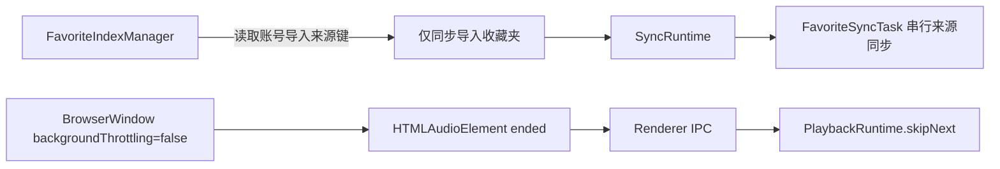

# 桌面收藏同步与后台播放修复记录

## 1. 背景与目标

本次处理三个桌面端问题：全局收藏索引同步容易触发 Bilibili 限流、设置页缺少“仅同步导入收藏夹”入口，以及窗口最小化后歌曲结束不能及时自动切歌。

目标是降低同步请求的同时并发量，复用音乐库当前保存的导入来源选择，并确保最小化状态下 Renderer 仍能及时把媒体结束事件交给主进程。

## 2. 现状与根因

- `DesktopLibraryRuntime.synchronize` 将来源交给 `FavoriteSyncTask`，桌面端此前沿用共享配置的 `playlistConcurrency = 3`；多个来源会同时拉取分页，叠加 Bilibili 接口的自适应令牌桶后仍容易触发限流。
- 音乐库在 `localStorage` 中保存当前账号的导入来源键，但设置页的 `FavoriteIndexManager` 只提供全选、同步选中和删除选中，历史上的快捷同步入口在 UI 重构时被移除。
- 自动切歌链路是 `HTMLAudioElement.ended → Renderer IPC → PlaybackRuntime.skipNext`。Electron 窗口没有关闭后台节流配置，最小化后 Renderer 的媒体事件和 IPC 调度可能延迟到窗口恢复。

## 3. 方案与核心修改

- `desktop/main/constants.ts`
  - 将 PC 端来源同步并发数固定为 `1`，单个来源分页并发继续保持 `1`；不改共享核心配置，避免影响 Android 端。
- `desktop/renderer/App.tsx`
  - 恢复“仅同步导入收藏夹”按钮。
  - 从 `nyami-imported-sources-{uid}` 读取音乐库当前导入来源，只保留当前远端目录仍存在的来源键，调用现有 `sync.start({sourceKeys})`。
- `desktop/main/window/createWindow.ts`
  - 设置 `webPreferences.backgroundThrottling = false`，让最小化窗口继续及时派发媒体事件和处理 IPC，从而维持自动切歌链路。

## 4. 风险与影响范围

- 全局索引同步耗时可能增加，但请求峰值和多个收藏夹同时访问造成的限流风险下降。
- 快捷按钮依赖音乐库的本地导入来源选择；没有登录、来源目录为空或导入列表为空时按钮保持禁用。
- 禁用 Renderer 后台节流会增加最小化期间的 Renderer 调度开销，范围仅限桌面窗口，换取后台播放事件可靠性。

## 5. 验证方案与结果

- 已通过 `git diff --check` 检查本次差异无空白错误。
- 未执行自动化测试和 Electron 实机最小化播放验证；当前修改需要在 Windows 桌面端实际最小化并等待歌曲结束后补做运行时验收。

## 6. 最终结论

桌面端索引同步已改为单来源串行，设置页恢复了按音乐库导入范围同步的快捷入口，窗口最小化时保留媒体事件处理能力。真实 Bilibili 限流表现和 Windows 实机后台切歌仍需在目标环境补验。
